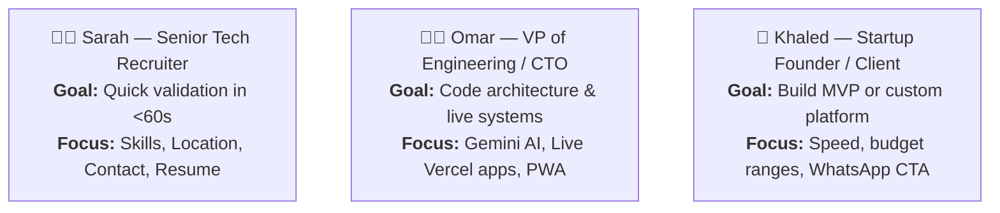
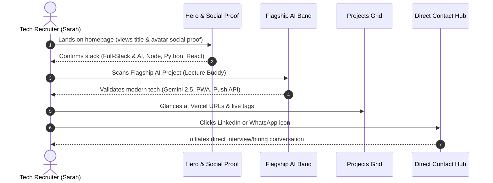
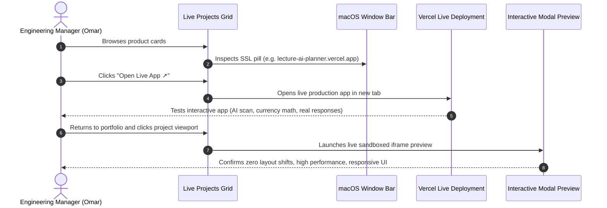
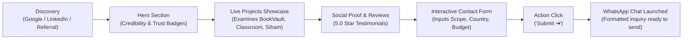
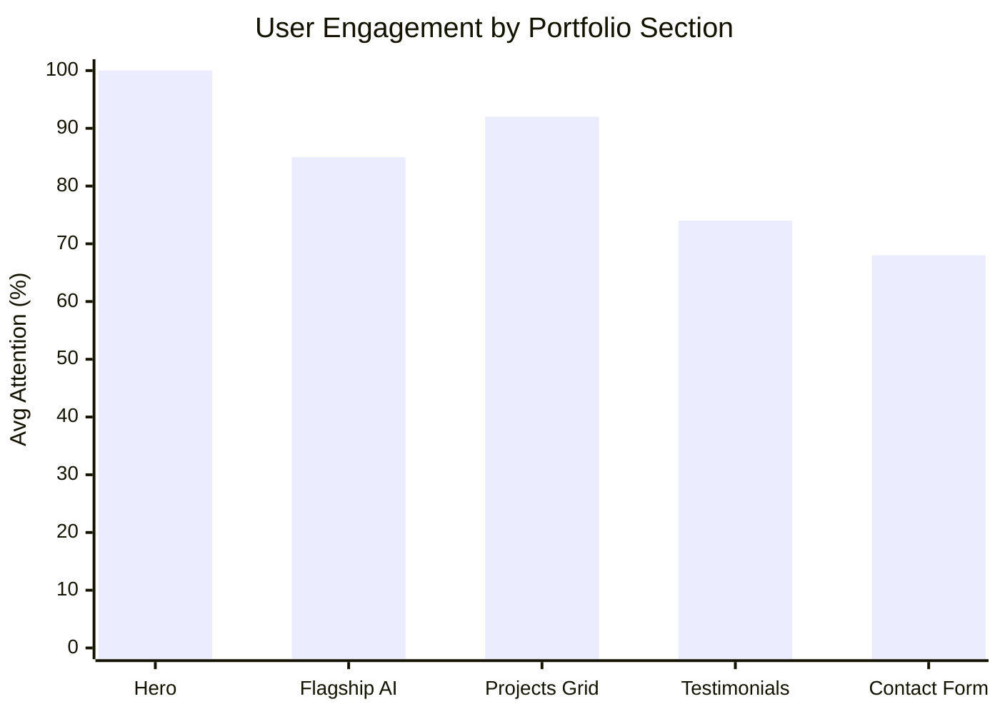

# Product Requirements Document (PRD) & User Journey Map

**Project**: Professional Developer Portfolio & Live Systems Hub  
**Owner**: Youssef Saber Ahmed — Full-Stack & AI Software Developer  
**Status**: Production Ready & Deployed on Vercel / Local LAN  
**Version**: 2.0 (Unified 60-30-10 Design System)  
**Repository**: [github.com/youssefsaberahmed14-ui/portofolio](https://github.com/youssefsaberahmed14-ui/portofolio.git)  

---

## 1. Executive Summary & Vision

The primary objective of this portfolio platform is to transition the user experience from a passive "resume viewer" into an **interactive product showcase**. Instead of merely listing code repositories or static mockups, every featured system provides direct access to live, functioning production deployments on Vercel.

### Core Value Proposition
- **Demonstrated Competence**: Direct proof-of-work through functioning AI integrations (Google Gemini Vision API), modern frontend architectures (PWAs, responsive layouts), and backend microservices.
- **Unified Visual Luxury**: A strict, distraction-free **60-30-10 color architecture** (Deep Midnight Slate, Crisp White/Mist, Radiant Golden Amber) that highlights quality and technical maturity.
- **Frictionless Lead Conversion**: Dual-action contact avenues combining direct phone/email/LinkedIn links with an interactive inquiry form that formats customized messages straight into WhatsApp.

---

## 2. Visual Architecture & Design Tokens (60-30-10 System)

To eliminate visual clutter and present an executive-level aesthetic, all design tokens strictly conform to the 60-30-10 rule:

| Category | Token / Value | Proportion | Purpose & Application |
|---|---|---|---|
| **Primary Base (Structure & Typography)** | `#0f172a` (Deep Midnight Slate) | **60%** | Page headlines, primary text, dark action buttons, macOS browser window frames, high contrast. |
| **Secondary Base (Surface & Canvas)** | `#ffffff` (Pure White) & `#f8fafc` (Soft Mist) | **30%** | Section backgrounds, card containers, form fields, light borders (`#e2e8f0`). |
| **Accent Focus (Action & Attention)** | `#f59e0b` / `#d97706` (Radiant Amber) | **10%** | **Reserved exclusively for focus**: Key CTA buttons, star ratings, italic serif highlights, hover arrows, contact icon circles. |

### Typography Hierarchy
- **Display Headings**: `Bricolage Grotesque` (Weights: 600, 700; Letter-spacing: `-0.025em`).
- **Body & UI Elements**: `Inter` (Weights: 400, 500, 600, 700; Line-height: `1.7`).
- **Focus Serif Accent**: `Playfair Display` (*Italic*, Weight: 600; Color: `#d97706`). Used to emphasize critical terms in titles (e.g. *precision & intelligence*, *Your Next Projects*, *Client Testimonials*).
- **System Metrics / URLs**: `JetBrains Mono` (Weights: 500; Size: `12px - 14px`).

---

## 3. User Personas

### Persona A: The Fast-Paced Recruiter ("Sarah")
- **Profile**: Talent Acquisition Specialist sourcing senior/mid-level Full-Stack and AI engineers.
- **Time on Site**: 45 to 90 seconds.
- **Critical Needs**:
  1. Immediate clarity on core technical stack (Node.js, Python, React, Gemini AI, PWA).
  2. Geographic location & availability (Cairo, Egypt / Remote Worldwide).
  3. One-click direct channels (LinkedIn, WhatsApp, Email).

### Persona B: The Technical Lead / CTO ("Omar")
- **Profile**: Engineering manager evaluating architecture, real-world deployment viability, and problem-solving capability.
- **Time on Site**: 3 to 7 minutes.
- **Critical Needs**:
  1. Real running applications on Vercel with zero 404s.
  2. Evidence of multi-modal AI integration (Gemini Vision schedule parsing in *Lecture Buddy*).
  3. Clean responsive layout across desktop and mobile devices.

### Persona C: The Founder / Business Owner ("Khaled")
- **Profile**: Business owner seeking an engineer to build or revamp a digital product.
- **Time on Site**: 2 to 5 minutes.
- **Critical Needs**:
  1. Social proof and credibility (testimonials, 5.0 client satisfaction rating).
  2. Structured inquiry options (Budget range dropdown, project type selection).
  3. Rapid turnaround communication (direct WhatsApp trigger with pre-filled scope).

---

## 4. User Journey Maps

### Journey 1: The 60-Second Recruiter Evaluation

---

### Journey 2: The CTO Deep-Dive & Verification Flow

---

### Journey 3: The Client Inbound Conversion Flow

---

## 5. Functional Requirements (FR)

### FR-1: Navigation & Global Header
- **FR-1.1**: Sticky top navigation with translucent glassmorphism background (`rgba(255, 255, 255, 0.9)` + `backdrop-filter: blur(10px)`).
- **FR-1.2**: Brand identifier with amber focal point (`YOUSSEF.`).
- **FR-1.3**: Direct anchor navigation links (`#featured`, `#projects`, `#journey`, `#testimonials`, `#contact`).
- **FR-1.4**: Primary CTA button ("Let's Talk →") directing immediately to the contact form.

### FR-2: Hero Section & Immediate Value Proposition
- **FR-2.1**: Prominent headline with serif italic accent: *"Engineering scalable web apps with precision & intelligence."*
- **FR-2.2**: Social proof cluster displaying engineer avatar, collaborative peer avatars, 5-star rating icon, and trust label.
- **FR-2.3**: Dual CTA action row:
  - `✦ Explore Projects` (Primary amber focus button).
  - `Get in Touch` (Secondary ghost button).
- **FR-2.4**: macOS floating window viewport featuring the developer's professional photo and dynamic floating tech stack badge.

### FR-3: Flagship Feature Band (Lecture Buddy AI)
- **FR-3.1**: Dedicated full-width contrast band highlighted in `#f8fafc` surface.
- **FR-3.2**: Feature tags: `✨ Gemini 2.5 Active` and `100% PWA`.
- **FR-3.3**: Technical breakdown detailing Google Gemini Vision multi-modal API timetable extraction and automated Web Push notification logic.
- **FR-3.4**: Direct CTA: `Explore Lecture Buddy ↗` opening `https://lecture-ai-planner.vercel.app` in a new tab.

### FR-4: Live Deployed Projects Showcase
- **FR-4.1**: Card design styled as native macOS application windows featuring traffic-light window controls (Red, Amber, Green).
- **FR-4.2**: Browser URL pill displaying the verified live Vercel domain with an SSL lock icon.
- **FR-4.3**: Clickable viewport allowing visitors to click directly on the preview to open the live site.
- **FR-4.4**: Explicit `Open Live App ↗` button in every card footer.
- **FR-4.5**: Comprehensive coverage of 8 live Vercel projects:
  1. **Lecture Buddy AI**: `https://lecture-ai-planner.vercel.app`
  2. **Classroom App**: `https://classroom-app-beta.vercel.app`
  3. **BookVault**: `https://book-vault-sepia-eta.vercel.app`
  4. **Currency Converter**: `https://currency-converter-amber-beta.vercel.app`
  5. **Zoom Free (WebRTC)**: `https://youssefsaberahmed14-ui-zoom-clone.vercel.app`
  6. **Weatherly**: `https://weather-website-gray-ten.vercel.app`
  7. **Nour Academy**: `https://study-ashen-six.vercel.app`
  8. **Siham Furniture**: `https://siham-furniture-landing.vercel.app`

### FR-5: Career Journey & Education
- **FR-5.1**: Chronological progression displaying education, software development milestones, and technical specializations.
- **FR-5.2**: Amber-highlighted period badges (`2024 — PRESENT`, `2023 — 2024`, `2020 — 2024`).

### FR-6: Client Testimonials (Wall of Impact)
- **FR-6.1**: Header tag `- Clients Testimonials` with serif italic accent: *Client Testimonials*.
- **FR-6.2**: 3-column responsive card layout.
- **FR-6.3**: Five golden star badges (`★★★★★`) with numeric score (`5.0`) at the top of each card.
- **FR-6.4**: Verified stakeholder metadata: Client name, company position, and initial avatar badge.

### FR-7: Inbound Lead Generation & Contact Hub
- **FR-7.1**: Header tag `- Contact Us` with title: *Let's Talk for Your Next Projects*.
- **FR-7.2**: Left column direct contact channels with amber circular icons:
  - Phone: `+20 102 961 9067`
  - Email: `youssefsaberahmed14@gmail.com`
  - LinkedIn: `linkedin.com/in/youssef-ahmed-552b89307`
  - Location: `Cairo, Egypt`
- **FR-7.3**: Right column 2-column form capturing:
  - `Your Name *`
  - `Email *`
  - `Phone *`
  - `I'm Interested in *` (Dropdown: AI Web App, Full-Stack, PWA, Backend API, Other)
  - `Budget Range (USD) *` (Dropdown: < $1,000, $1k - $3k, $3k - $5k, $5k+)
  - `Country *` (Dropdown: Egypt, Saudi Arabia, UAE, USA, UK, Germany, Canada, Other)
  - `Your Message *` (Textarea)
- **FR-7.4**: Signature dark pill submit button with radiant amber arrow circle (`Submit ➔`).
- **FR-7.5**: Client-side submission payload assembly that encodes all fields and opens WhatsApp Web / App directly to `+20 102 961 9067`.

---

## 6. Non-Functional Requirements (NFR)

| ID | Category | Requirement Specification | Verification Method |
|---|---|---|---|
| **NFR-1** | **Performance** | Page weight < 250 KB (excluding images). Zero external JS runtime frameworks (Pure Vanilla JS). First Contentful Paint (FCP) < 0.8s. | Chrome DevTools Lighthouse audit. |
| **NFR-2** | **Responsiveness** | Fluid responsiveness across 320px (Mobile S) to 2560px (4K monitors). Seamless single-column stack on mobile devices. | Multi-viewport testing & mobile LAN testing (`http://192.168.1.98:5500`). |
| **NFR-3** | **Accessibility (a11y)** | Strict WCAG 2.1 AA contrast ratio (minimum 4.5:1 for body copy, 7:1 for headings). AAA contrast on all amber interactive buttons. | Chrome DevTools Contrast Checker. |
| **NFR-4** | **Cross-Origin Security** | All external links open with `target="_blank"` and `rel="noopener noreferrer"`. All iframes configure minimal necessary permissions. | Code inspection and W3C link validator. |
| **NFR-5** | **Offline LAN Preview** | Server bound to `0.0.0.0:5500` allowing instant local Wi-Fi testing via QR code and direct IPv4 address. | Successful mobile smartphone validation. |

---

## 7. Conversion Funnel & Engagement Metrics

### Key Performance Indicators (KPIs):
1. **Live App Click-Through Rate (CTR)**: Target > 35% of unique visitors opening at least one live Vercel app.
2. **Flagship Deep Dive Rate**: Target > 25% of visitors exploring *Lecture Buddy*.
3. **Form-to-WhatsApp Conversion Rate**: Target > 8% of visitors submitting an inquiry.
4. **Mobile Usability Score**: 100/100 on Google Mobile-Friendly test.
